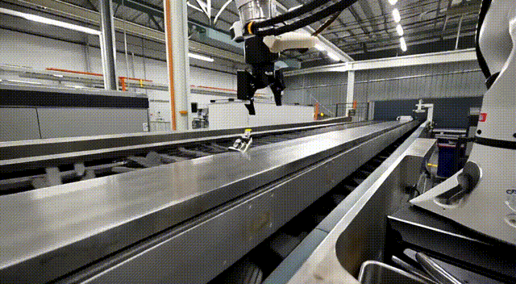

# NVIDIA Cosmos on Dell Pro Max with GB10 — Text-to-Video World Model Deployment

Deploying **NVIDIA Cosmos Predict 2.5** (a Physical AI *world foundation model*) on a
**DGX Spark** (Dell Pro Max with GB10, aarch64, sm_121) and generating video from a text
prompt — with every missing package and aarch64 / CUDA-13 fix I hit along the way.



*Industrial robot-arm pick-and-place — text-to-video generated locally on a Dell Pro Max with GB10 with Cosmos Predict 2.5 (2B).*

## Baseline
- NVIDIA DGX Spark (Dell Pro Max with GB10), aarch64
- DGX OS (Ubuntu 24.04), NVIDIA driver 580.x, CUDA 13.0
- Cosmos Predict 2.5 — 2B model, BF16, ~32.5 GB VRAM (fits the Spark's ~90 GB)

## 1. Clone the Cosmos repo
```bash
git clone https://github.com/nvidia-cosmos/cosmos-predict2.5.git ~/cosmos-predict2.5
cd ~/cosmos-predict2.5
git lfs pull
```

## 2. Install uv (the package manager Cosmos uses)
Use the official installer — **not** the `snap` it suggests (snap confinement blocks the model-cache dirs):
```bash
curl -LsSf https://astral.sh/uv/install.sh | sh
source ~/.bashrc          # or: export PATH="$HOME/.local/bin:$PATH"
uv --version
```

## 3. Build the environment (Blackwell / CUDA 13)
```bash
uv sync --extra=cu130
```
The `cu130` extra is **required** on GB10 — it pulls the CUDA-13 / Blackwell PyTorch build.
Verify you got the GPU build, not CPU:
```bash
python -c "import torch; print(torch.__version__, torch.cuda.is_available(), torch.version.cuda)"
# expect: 2.9.x+cu130 True 13.0
```
> ⚠️ **Biggest gotcha:** `uv run <cmd>` re-syncs the env *without* your extras and silently
> swaps CUDA torch back to the CPU build (`+cpu`). Always either pass `--extra=cu130` on
> every `uv run`, or `source .venv/bin/activate` and use plain `python`. A CPU-only torch
> is what triggers the `transformer_engine ... undefined symbol: ...getCurrentCUDAStream` error.

## 4. Install the missing system package (FFmpeg)
Cosmos uses `decord` for video, which needs FFmpeg's shared libs (`libavformat.so.60`):
```bash
sudo apt update && sudo apt install -y ffmpeg
```

## 5. Authenticate to Hugging Face & accept model licenses
```bash
uv run huggingface-cli login     # paste a READ token (needs gated-repo read access)
```
Then open each gated model page in a browser (logged in) and click **Agree and access repository**:
- https://huggingface.co/nvidia/Cosmos-Predict2.5-2B
- https://huggingface.co/nvidia/Cosmos-Guardrail1   *(or skip it with `--disable-guardrails`)*
- https://huggingface.co/nvidia/Cosmos-Reason1-7B   *(pulled in by the guardrail stack)*

(Optional) keep the multi-GB checkpoints on a known disk:
```bash
export HF_HOME=~/cosmos-predict2.5/hf_cache
```

## 6. Write the text-to-video prompt
```bash
cat > assets/base/robot_arm.json << 'EOF'
{
  "inference_type": "text2world",
  "name": "robot_arm_pick_place",
  "prompt": "A six-axis industrial robotic arm picking up a small metal part from a moving conveyor belt and placing it into a bin. Modern factory floor, bright industrial lighting, side view, smooth continuous motion."
}
EOF
```

## 7. Generate the video
```bash
source .venv/bin/activate
python examples/inference.py \
  -i assets/base/robot_arm.json \
  -o outputs/robot_arm_pick_place \
  --inference-type=text2world \
  --model 2B/post-trained \
  --num-steps 35 \
  --seed 7 \
  --disable-guardrails
```
First run downloads the checkpoints (Wan VAE tokenizer, Cosmos-Reason1-7B ~16.6 GB,
Cosmos-Predict2.5-2B weights ~4 GB), then writes a ~5-second 720p (1280×704) 16 fps clip
to `outputs/robot_arm_pick_place/`. Generation is ~20–30 s on the GB10 after load.

Copy it to your local machine:
```bash
scp <user>@<spark-ip>:"~/cosmos-predict2.5/outputs/robot_arm_pick_place/*.mp4" .
```

## Sample output
`robot_arm_pick_place.mp4` in this repo was generated with the exact command above.

## Model options
| Model | Notes |
|---|---|
| `2B/post-trained` | Recommended — fast (~20 s/clip) |
| `2B/distilled` | Fastest (fewer steps) |
| `14B/post-trained` | Higher quality; fits 128 GB unified memory but much slower |

One unified checkpoint handles all modes: `text2world`, `image2world`
(add `--input-path image.png`), and `video2world` (add `--input-path clip.mp4`).

## Known GB10 notes
- The `cu130` extra is mandatory; the CUDA-12.8 (x86_64) path does **not** work on aarch64.
- Only BF16 is tested; Linux only.
- If you OOM, trade memory for speed with `--offload-tokenizer`, `--offload-text-encoder`, `--offload-diffusion-model`.

## Troubleshooting
| Symptom | Fix |
|---|---|
| `uv: command not found` (suggests snap) | use the official installer, not snap (step 2) |
| `transformer_engine ... undefined symbol: ...getCurrentCUDAStream` | torch is CPU-only — `uv sync --extra=cu130`, confirm `torch.cuda.is_available()` is True |
| torch shows `+cpu` after a `uv run` | `uv run` dropped the extra — re-sync with `--extra=cu130`, then use the activated venv + plain `python` |
| `OSError: libavformat.so.60: cannot open shared object file` | `sudo apt install -y ffmpeg` |
| `Access denied. Model '...' requires approval` | accept the license on that model's HF page; use a READ token with gated-repo access |
| guardrail model gated / won't download | accept `nvidia/Cosmos-Guardrail1`, or add `--disable-guardrails` |
| `externally-managed-environment` on `pip install` | don't use system pip — work inside the uv `.venv` |
| CUDA OOM | add the `--offload-*` flags |


